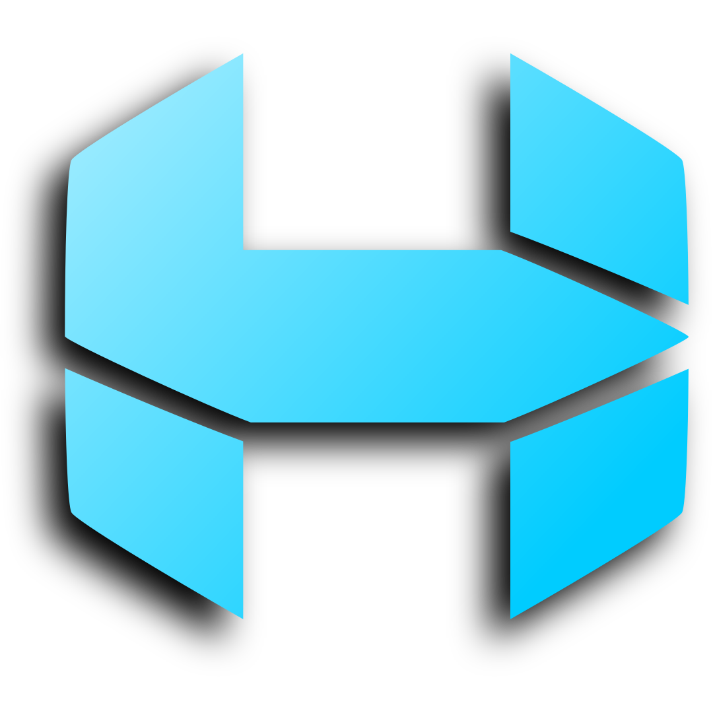

<div align="center">



# HexxlaDB

**An embedded Go database for topic neighborhoods, bounded retrieval, and explicit revisions.**

[](https://github.com/hexxla/hexxladb/actions/workflows/ci.yml)
[](https://pkg.go.dev/github.com/hexxla/hexxladb)
[](https://github.com/hexxla/hexxladb/tags)
[](LICENSE)

</div>

HexxlaDB stores records as cells on a sparse hex grid. Search by text, tags,
or application-supplied vectors, then expand around the results to find nearby
or linked context. Each cell can carry provenance, confidence, and a validity
window. Seams record contradictions and supersession between cells. The library
stores and queries records directly in your Go process.

## Group records by topic

Give each topic an anchor coordinate and place new cells within a bounded
radius. For example, put **Backups** at `(0,0)` and **Migration** at `(10,0)`,
with two placement rings per topic. Cells from the two groups are at least
six hex steps apart, so the other group lies outside a three-ring radial
scan from any cell in either group. Tags let you find topic records from
anywhere on the grid.

Your application chooses the anchors, radii, and tags. Use
`FindUnusedCellPlacement` and `PutCell` in the same `DB.Update` to allocate
a new record without reusing a recorded tombstone. Graph edges and supersession
can deliberately connect records across neighborhoods.
[Placement and coordinate guide](docs/hexxladb/API_REFERENCE.md#coordinates-and-records)

## Quick start

### Run the example from a checkout

Use the Go version in [`go.mod`](go.mod) or newer.

```sh
git clone https://github.com/hexxla/hexxladb.git
cd hexxladb
go run ./examples/quickstart
```

The [quickstart](examples/quickstart/) creates a temporary database, places two
records, finds a seed with a bounded lexical query, and follows a `requires`
edge to assemble context. It renders a sample prompt with an application-owned
word budget. With Task installed, `task demo` runs the same example.

### Install the released library

From your own Go module, install the tagged release.

```sh
go get github.com/hexxla/hexxladb@v0.7.0
```

Use the [tagged README](https://github.com/hexxla/hexxladb/blob/v0.7.0/README.md)
for that version. The example and explorer commands on this page run the
current checkout.

## Choose how to retrieve context

- **Find seeds.** `QueryCells` supports lexical search, structured filters, and
  optional vector similarity. Filtered HNSW search is approximate.
  `QueryCellsWithStats` reports when the candidate budget ends the search.
  For exact scoring over a bounded scan, set `MaxScanRows` with a required
  tag, source, or radius. Row-limited scans can return partial hits with
  `ErrQueryScanLimit`.
  [Query guide](docs/hexxladb/API_REFERENCE.md#query-and-content-search)
- **Expand from a seed.** `LoadContext` scans neighboring rings or follows
  selected edge types. It can include facets and seams and resolve supersession.
  Result and traversal limits bound database work. Applications own prompt
  ranking and model-specific token accounting.
  [Context guide](docs/hexxladb/API_REFERENCE.md#context-assembly-and-spatial-retrieval)
- **Use visibility when space matters.** `LoadContextFOV` selects visible
  cells in all directions around a seed using the caller's opacity rule.
  [Spatial retrieval guide](docs/hexxladb/API_REFERENCE.md#specialized-retrieval)

## Terminal explorer

From the checkout with Task installed, create the synthetic fixture once and
open it.

```sh
task seed
task tui
```

- **Cells.** Press `/` to search, then Enter on a result to inspect it.
- **Inspector.** Press `c` for a three-ring radial context pack or `d` for
  cell details. Scroll with the arrows or Page Up and Page Down. Press Esc to return.
- **Hex Grid.** Press `2` to open the grid and `v` to show visibility from
  its center. The explorer treats empty hexes as obstacles.

Use Tab or `1`–`5` to switch views and `?` for contextual shortcuts.
Open an existing database with `task tui TUI_DB=/path/to/existing.db`.
The explorer takes the exclusive database lock. Its optional semantic and
hybrid search modes use local Ollama. See the
[operator guide](docs/hexxladb/OPERATIONS.md#terminal-explorer) for credentials,
fixture paths, and diagnostics.

## Examples and documentation

- [Ports and adapters](examples/ports_adapters/) demonstrates recording and
  resolving a contradiction through an application-owned port.
- [Remote access](examples/remote_access/) demonstrates an authenticated
  loopback service that owns the database files.
- [API guide](docs/hexxladb/API_REFERENCE.md) covers records, search, graph
  traversal, and context assembly. The [memory model](docs/hexxladb/HEXXLA.md)
  explains placement, validity, and contradictions.
- [Operations](docs/hexxladb/OPERATIONS.md) covers backups, migrations,
  compaction, and diagnostics. See also the [encryption model](docs/hexxladb/ENCRYPTION.md).
- [Performance evidence](docs/hexxladb/PERFORMANCE_EVIDENCE.md) records dated
  benchmarks and the workloads under [`tools/evidence`](tools/evidence/).
  Use `task bench-api` to measure the current checkout. Commits are serialized.
  Batch related writes in `DB.Update` to share one durable commit.
- [Compatibility policy](VERSIONING.md) and [roadmap](docs/ROADMAP.md) describe
  upgrade expectations and planned work.

`task build` builds the CLI and TUI. `task build-examples` compiles the examples.

## Contributing

See [CONTRIBUTING.md](CONTRIBUTING.md) for setup and checks. Run `task ci`
before pushing. Report bugs in [Issues](https://github.com/hexxla/hexxladb/issues)
or share ideas in [Discussions](https://github.com/hexxla/hexxladb/discussions).

Used by [Mosaic](https://github.com/hexxla/mosaic) and the
[Hexxla stack](https://github.com/hexxla/hexxla).
